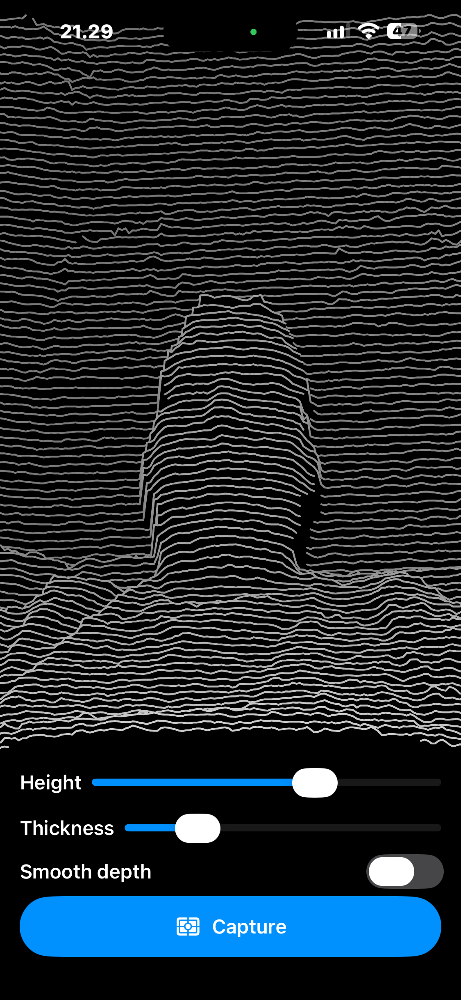

# Depth Scanner

An iPhone app that shows the front TrueDepth (Face ID) camera's depth as horizontal lines.

- 100 horizontal lines connect raw depth points. Lines rise where things are closer
  (height = 20 cm ÷ distance, so the full range is shown). Lower lines hide the ones behind them.
- **Height** and **Thickness** sliders.
- **Smooth depth** toggle: fills holes in the depth map using the color image (off = raw sensor data).
- **Capture** freezes the view and grabs a full-resolution 3D point cloud (up to ~300k points).
  **Export PLY** shares it as a `.ply` file for Blender, MeshLab or CloudCompare.

Works best from about 20 cm to 1 m. Needs a physical iPhone with Face ID (the Simulator has no depth camera).

## Run it on your iPhone

1. Open `TrueDepthScanner.xcodeproj` in Xcode.
2. Select the **TrueDepthScanner** target → **Signing & Capabilities** → choose your **Team**
   (add your Apple ID under Xcode → Settings → Accounts if none is listed; a free account works).
   If the bundle ID is taken, change it to something unique.
3. Plug in the iPhone, unlock it, and pick it as the run destination at the top of Xcode.
4. On the phone, turn on **Settings → Privacy & Security → Developer Mode** (it restarts).
5. Press **Run** (⌘R). The first time, the phone may ask you to trust the developer:
   **Settings → General → VPN & Device Management** → your Apple ID → Trust.

With a free account, the app stops opening after 7 days. Run it from Xcode again to renew it.

## Code

| File | What it does |
| --- | --- |
| `DepthCaptureEngine.swift` | Sets up the TrueDepth camera (AVFoundation) and delivers synchronized color + depth frames |
| `DepthProcessor.swift` | Samples depth for the lines, center distance, and 3D points for captures |
| `DepthViewModel.swift` | App state: start camera, capture, resume, export |
| `DepthLinesView.swift` | Draws the lines |
| `PLYExporter.swift` | Writes a binary PLY file |
| `ContentView.swift` | The UI |
